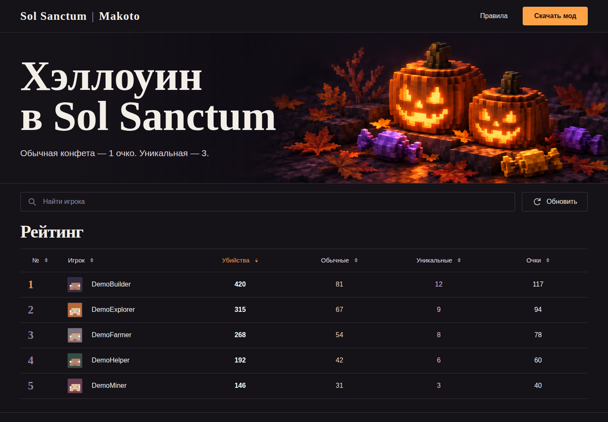

**English** · [Русский](README.ru.md)


# Sol Sanctum · Halloween

A local-first Fabric event counter and a self-hosted leaderboard for Minecraft Halloween events.

[](https://github.com/ari3lYT/sol-sanctum-halloween/actions/workflows/ci.yml)
[](LICENSE)

[Quick start](#quick-start) · [Architecture](docs/architecture.md) · [Development](docs/development.md)


## See it



## Included

- A Fabric client mod for **1.21.11, 26.2 and 26.3**; the server needs no custom plugin.
- Local kill/candy profiles, movable HUD, configurable keys, safe reset and persisted statistics.
- A React leaderboard with search, sortable columns and installation/download guidance.
- A standard-library Python API using SQLite, per-installation upload keys and monotonic snapshot sequences.

Pumpkin-headed mobs award ordinary candy; jack-o'-lantern heads award unique candy. Rules distinguish
observed attribution from baseline server kill statistics. This is a client-reported event leaderboard,
not an authoritative anti-cheat or server-side economy.

## Quick start

Build the mod with JDK 25 (the 1.21.11 target emits Java 21 bytecode):

```bash
cd mod
./gradlew build
cd ..
python tools/prepare_downloads.py
```

Install the JAR matching your game version and its matching Fabric API. Open the interface with **K**,
toggle HUD with **H**, and hold **Tab** for the summary. **Website synchronization is off by default.**

Run the website with Node.js 22+ and Python 3.11+:

```bash
cd website
npm ci
npm run build
python server/app.py --public dist --db data/halloween.sqlite3
```

Open `http://127.0.0.1:18126/halloween/`. See [configuration](docs/configuration.md) to configure your
own synchronization endpoint, TLS origin and download assets. Source distributions contain no
player database or upload identities; third-party Fabric API JARs are not bundled.

## Development

```bash
cd mod && ./gradlew test
cd ../website && npm test
python -m unittest discover -s tests -p 'test_*.py' -v
```

See [architecture](docs/architecture.md) for attribution boundaries and [development](docs/development.md)
for source layout, testing and rebuilding download files.

[Release verification and limits](docs/verification.md) · [Changelog](CHANGELOG.md)
