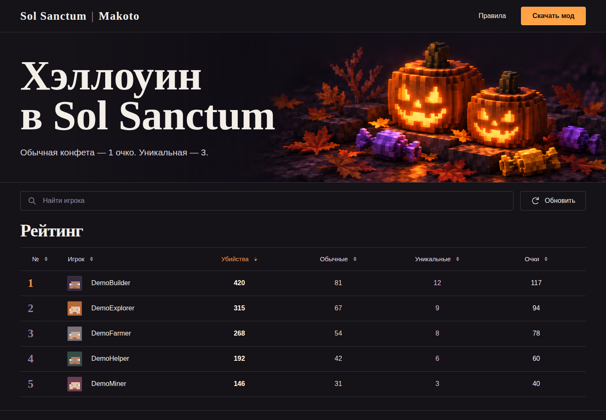

[English](README.md) · **Русский**


# Sol Sanctum · Halloween

Fabric-счётчик с локальным хранением и таблица лидеров для собственного сервера: хэллоуинские события в Minecraft.

[](https://github.com/ari3lYT/sol-sanctum-halloween/actions/workflows/ci.yml)
[](LICENSE)

[Быстрый старт](#быстрый-старт) · [Архитектура](docs/architecture.ru.md) · [Разработка](docs/development.ru.md)

## Скриншот



## Состав проекта

- Клиентский Fabric-мод для **1.21.11, 26.2 и 26.3**; серверный плагин не требуется.
- Локальные профили убийств и конфет, перемещаемый HUD, настраиваемые клавиши, безопасный сброс и сохранение статистики.
- Таблица лидеров на React с поиском, сортировкой и инструкциями по установке и скачиванию.
- Python API на стандартной библиотеке: SQLite, отдельные ключи загрузки для каждой установки и монотонные номера снимков.

Мобы с тыквой на голове дают обычные конфеты, со светильником Джека — уникальные. Правила различают наблюдаемое подтверждение убийства и базовую серверную статистику. Таблица получает данные от клиентов; она не обеспечивает достоверность уровня серверного античита или экономики.

## Быстрый старт

Соберите мод с JDK 25; цель 1.21.11 создаёт байткод Java 21:

```bash
cd mod
./gradlew build
cd ..
python tools/prepare_downloads.py
```

Установите JAR для своей версии игры и соответствующий Fabric API. **K** открывает интерфейс, **H** переключает HUD, удержание **Tab** показывает сводку. **Синхронизация с сайтом по умолчанию отключена.**

Для сайта нужны Node.js 22+ и Python 3.11+:

```bash
cd website
npm ci
npm run build
python server/app.py --public dist --db data/halloween.sqlite3
```

Откройте `http://127.0.0.1:18126/halloween/`. Свой адрес синхронизации, TLS origin и файлы для скачивания описаны в [настройках](docs/configuration.ru.md). В исходниках нет базы игроков или идентификаторов загрузки; сторонние JAR Fabric API не включены.

## Разработка

```bash
cd mod && ./gradlew test
cd ../website && npm test
python -m unittest discover -s tests -p 'test_*.py' -v
```

Границы определения авторства убийств описаны в [архитектуре](docs/architecture.ru.md), структура исходников, тестирование и обновление файлов скачивания — в [руководстве разработчика](docs/development.ru.md).

[Проверки релиза и их границы](docs/verification.ru.md) · [История изменений](CHANGELOG.ru.md)
