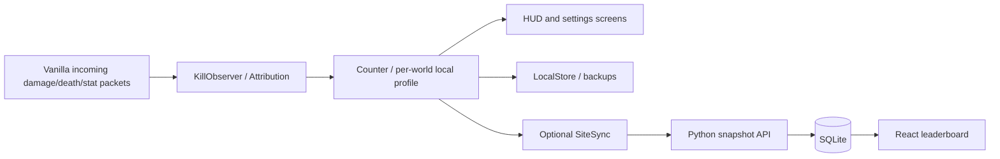

# Architecture

`mod/common` contains counting, attribution, persistence and optional synchronization. Version-specific
screens and platform glue live under `mod/versions`. An observed mob head is not enough on its own to
prove a kill: attribution uses damage/death evidence and reconciles available server statistics.
Offline or unobserved kills do not manufacture candy. Profiles separate worlds/servers and players.

`website/server/app.py` validates snapshot structure, rejects backwards sequence numbers and stores
keys separately from public totals. The API does not verify a client's truthfulness. Public leaderboard
fields are explicitly selected rather than exposing raw installation records.
