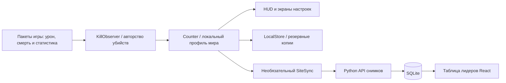

[English](architecture.md) · **Русский**

# Архитектура

`mod/common` содержит подсчёт, определение авторства убийств, хранение и необязательную синхронизацию. Экраны и платформенный код отдельных версий находятся в `mod/versions`. Наблюдения головы моба недостаточно для подтверждения убийства: используются сведения об уроне и смерти со сверкой доступной серверной статистики. Ненаблюдаемые убийства и убийства вне сессии не создают конфеты. Профили разделяют миры, серверы и игроков.

`website/server/app.py` проверяет структуру снимка, отклоняет уменьшение номера последовательности и хранит ключи отдельно от публичных итогов. API не проверяет правдивость клиента. Поля таблицы лидеров выбираются явно: исходные записи установок не публикуются целиком.
